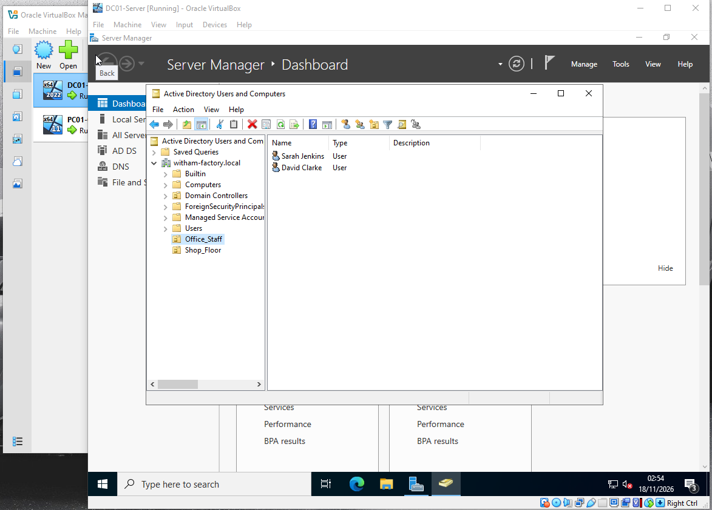
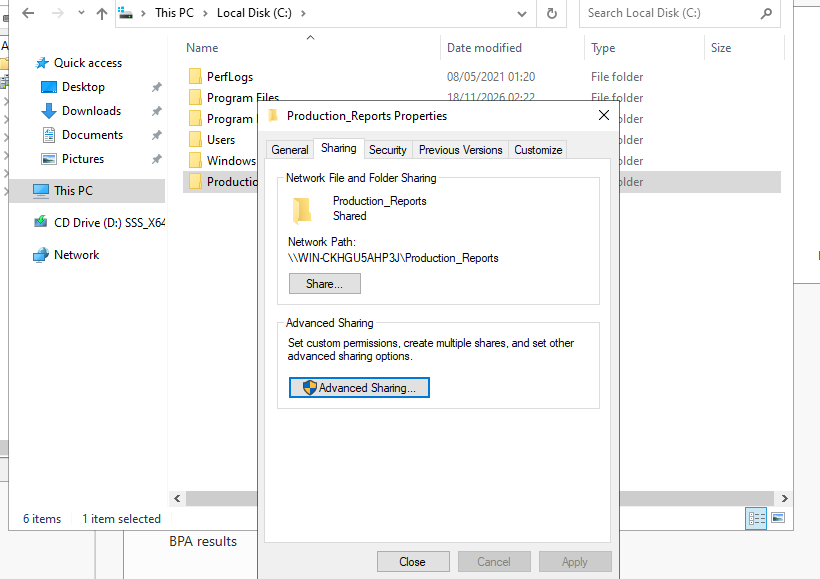
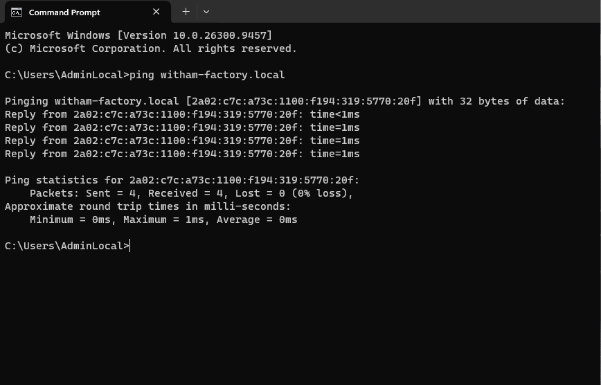
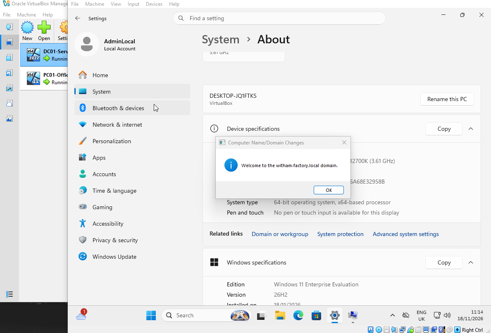
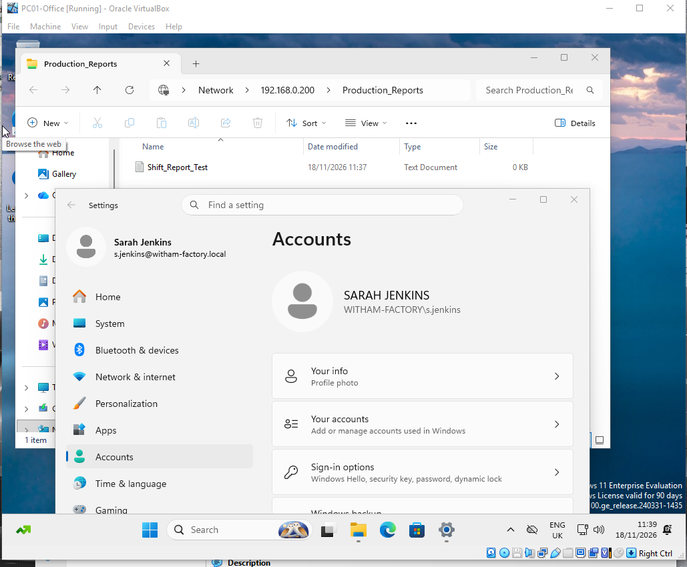
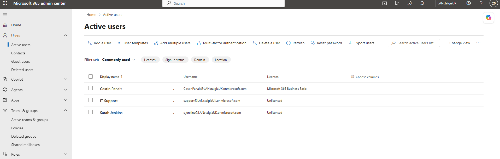

# Corporate Office & Production IT Support Home Lab

## Project Overview
This home lab simulates a hybrid corporate and manufacturing IT environment (`witham-factory.local`). It was built to practice and demonstrate core **1st Line IT Support** skills, including Windows Server administration, Active Directory user management, DNS and networking diagnostics, network file sharing, and Microsoft 365 administration.

## Technologies & Tools Used
* **Virtualization:** Oracle VM VirtualBox
* **Server OS:** Windows Server 2022 Standard (Desktop Experience)
* **Client OS:** Windows 11 Enterprise
* **Identity & Directory Services:** Active Directory Domain Services (AD DS), DNS
* **Cloud & Productivity:** Microsoft 365 Admin Center, Microsoft Entra ID

---

## Lab Implementation & Evidence

### 1. Active Directory Domain Services & Organizational Units
Promoted `DC01-Server` to a Domain Controller for `witham-factory.local` and structured the directory into Organizational Units (`Office_Staff` and `Shop_Floor`) to manage role-based user accounts.

### 2. Network File Sharing & NTFS Permissions
Configured a centralized shared directory (`Production_Reports`) on the server with custom sharing permissions to support cross-team collaboration between office and shop-floor staff.

### 3. DNS Configuration & Network Connectivity Testing
Configured static IP addressing on the server and pointed the client workstation (`PC01-Office`) to the internal DNS server. Verified name resolution and connectivity using `ping` diagnostics.

### 4. Joining Client Workstation to the Domain
Successfully joined the Windows 11 client machine (`PC01-Office`) to the `witham-factory.local` domain.

### 5. Domain User Authentication & Network Drive Access
Logged into the workstation using a standard domain user account (`WITHAM-FACTORY\s.jenkins`) and verified read/write access to the shared network drive (`\\192.168.0.200\Production_Reports`).

### 6. Microsoft 365 Administration
Practiced cloud administration tasks in the Microsoft 365 Admin Center, including provisioning user accounts, managing licenses, and configuring a dedicated `IT Support` Shared Mailbox.

